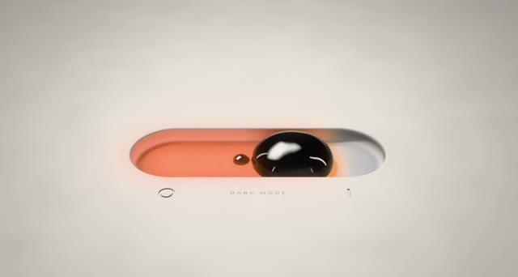

[← Back to gallery](../browse/interactive.en.md) · [简体中文](2119867622108066283.md)

# A Ferrofluid Toggle with Magnetic Droplets

**[🥔🥔🥔 · @argofowl](https://x.com/argofowl)** · 3D & interactive · 32s

> Discovery pool · Source verified; catalog details being completed.

**[▶ Open gallery to play](https://guanmo-ai.github.io/awesome-ai-motion/?lang=en#case-2119867622108066283)** · [Original post](https://x.com/argofowl/status/2119867622108066283)

Click the cover to open the gallery and play.

[Matching ferrofluid toggle source](https://github.com/argofowl/ferro-toggle) · [Try the ferrofluid toggle](https://argofowl.github.io/ferro-toggle/)

Black fluid gathers, stretches and splits inside a groove as droplets follow the switch. The creator credits a single Opus 5.5 HTML file and shares its source.

## Source & web pages

- **Direct source**：[Matching ferrofluid toggle source](https://github.com/argofowl/ferro-toggle) · [MIT](https://github.com/argofowl/ferro-toggle/blob/main/LICENSE)
  [Link source](https://x.com/argofowl/status/2119867622108066283) · Link checked 2026-11-15 05:59 UTC
- **Public web page**：[Try the ferrofluid toggle](https://argofowl.github.io/ferro-toggle/)
  [Link source](https://x.com/argofowl/status/2119867622108066283) · Link checked 2026-11-15 05:59 UTC

No public prompt has been verified. [View the original post](https://x.com/argofowl/status/2119867622108066283)

Bookmarks — · Likes — · Views —

## Source record

- Original post: [@argofowl](https://x.com/argofowl/status/2119867622108066283) · 2026-11-09T19:00:01.000Z
- Model attribution: Claude Opus 5.5 · [Creator’s statement](https://x.com/argofowl/status/2119867622108066283)
- Prompt lookup: [Creator post](https://x.com/argofowl/status/2119867622108066283) · 2026-11-15 05:51 UTC
- Cover source: [Original cover source](https://x.com/argofowl/status/2119867622108066283) · 7.124s
- Metrics snapshot: [Original X post](https://x.com/argofowl/status/2119867622108066283) · 2026-11-15 05:51 UTC
- Gallery video source: [Original post media record](https://x.com/argofowl/status/2119867622108066283) · 2026-11-15 05:59 UTC · Post/media correspondence and media response checked; external reference, no re-upload

Model attribution is based on creator statements. Prompts have not been independently rerun; sound and visuals have not received a uniform quality rating. Videos reference original post media, not our uploads; redistribution permission has not been verified.
