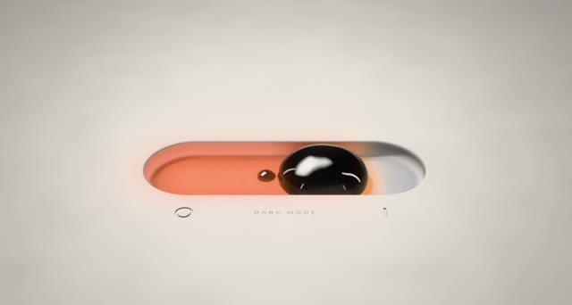

[← 返回图库](../browse/interactive.md) · [English](2119867622108066283.en.md)

# 磁流体开关：液滴跟着磁场滑动

**[🥔🥔🥔 · @argofowl](https://x.com/argofowl)** · 交互演示 · 32s

> 发现池 · 来源已核对，编目资料待完善。

**[▶ 打开画廊播放](https://guanmo-ai.github.io/awesome-ai-motion/#case-2119867622108066283)** · [作者原帖](https://x.com/argofowl/status/2119867622108066283)

点击封面打开画廊播放。

[对应磁流体开关源码](https://github.com/argofowl/ferro-toggle) · [体验磁流体开关](https://argofowl.github.io/ferro-toggle/)

黑色液体在凹槽内聚合、拉伸和分裂，小液滴跟随开关移动，形变与材质反光共同表达磁吸手感。作者说明 Opus 5.5 以单个 HTML 实现，并公开源码。

## 源码与网页

- **直接源码**：[对应磁流体开关源码](https://github.com/argofowl/ferro-toggle) · [MIT](https://github.com/argofowl/ferro-toggle/blob/main/LICENSE)
  [链接出处](https://x.com/argofowl/status/2119867622108066283) · 链接核对 2026-11-15 05:59 UTC
- **公开网页**：[体验磁流体开关](https://argofowl.github.io/ferro-toggle/)
  [链接出处](https://x.com/argofowl/status/2119867622108066283) · 链接核对 2026-11-15 05:59 UTC

未取得作者公开提示词。 [查看作者原帖](https://x.com/argofowl/status/2119867622108066283)

收藏 — · 点赞 — · 浏览 —

## 来源记录

- 作品原帖: [@argofowl](https://x.com/argofowl/status/2119867622108066283) · 2026-11-09T19:00:01.000Z
- 模型归因: Claude Opus 5.5 · [作者说明](https://x.com/argofowl/status/2119867622108066283)
- 提示词查阅记录: [作者原帖](https://x.com/argofowl/status/2119867622108066283) · 2026-11-15 05:51 UTC
- 封面来源: [原帖封面来源](https://x.com/argofowl/status/2119867622108066283) · 7.124s
- 互动快照: [X 原帖](https://x.com/argofowl/status/2119867622108066283) · 2026-11-15 05:51 UTC
- 画廊原视频: [原帖媒体记录](https://x.com/argofowl/status/2119867622108066283) · 2026-11-15 05:59 UTC · 已核对原帖媒体对应与媒体响应；外部引用，不重新上传

模型依据来自作者自述，未独立重跑提示词，也未对音画作统一质量评级。视频引用作者原帖媒体，未由本站重新上传，转载许可未确认。
