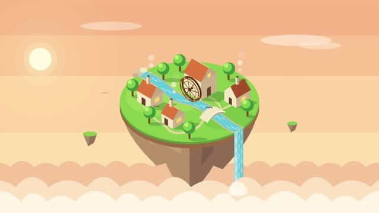

[← Back to gallery](../browse/characters.en.md) · [简体中文](2119876164051243409.md)

# An Isometric Watermill Village Above the Clouds

**[josen · @josendev](https://x.com/josendev)** · Pixel art & characters · 8s

> Discovery pool · Source verified; catalog details being completed.

**[▶ Open gallery to play](https://guanmo-ai.github.io/awesome-ai-motion/?lang=en#case-2119876164051243409)** · [Original post](https://x.com/josendev/status/2119876164051243409)

Click the cover to open the gallery and play.

Water runs through a village and falls into clouds while a waterwheel, birds and waterfalls create layered loops within a fixed composition. The creator credits Fable 5.2.

No public prompt has been verified. [View the original post](https://x.com/josendev/status/2119876164051243409)

Bookmarks — · Likes — · Views —

## Source record

- Original post: [@josendev](https://x.com/josendev/status/2119876164051243409) · 2026-11-09T19:33:57.000Z
- Model attribution: Fable 5.2 · [Creator’s statement](https://x.com/josendev/status/2119876164051243409)
- Prompt lookup: [Creator post](https://x.com/josendev/status/2119876164051243409) · 2026-11-15 05:51 UTC
- Cover source: [Original cover source](https://x.com/josendev/status/2119876164051243409) · 1.76s
- Metrics snapshot: [Original X post](https://x.com/josendev/status/2119876164051243409) · 2026-11-15 05:51 UTC
- Gallery video source: [Original post media record](https://x.com/josendev/status/2119876164051243409) · 2026-11-15 05:59 UTC · Post/media correspondence and media response checked; external reference, no re-upload

Model attribution is based on creator statements. Prompts have not been independently rerun; sound and visuals have not received a uniform quality rating. Videos reference original post media, not our uploads; redistribution permission has not been verified.
