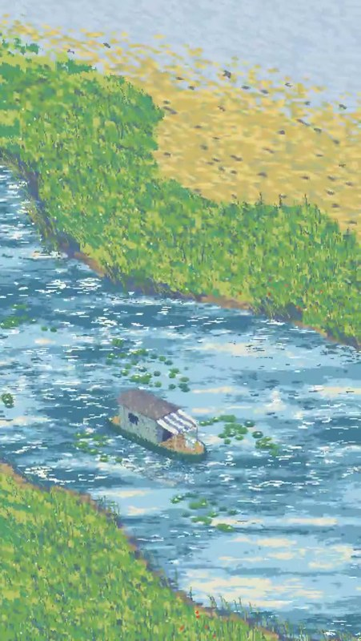

[← Back to gallery](../browse/characters.en.md) · [简体中文](2119881949540229421.md)

# A River Houseboat in Impressionist Pixels

**[逢見テノ · @aimi\_teno](https://x.com/aimi_teno)** · Pixel art & characters · 60s

> Discovery pool · Source verified; catalog details being completed.

**[▶ Open gallery to play](https://guanmo-ai.github.io/awesome-ai-motion/?lang=en#case-2119881949540229421)** · [Original post](https://x.com/aimi_teno/status/2119881949540229421)

Click the cover to open the gallery and play.

Small color marks form water, trees and a houseboat as the river scene changes from daylight to warm dusk. The creator credits Fable 5.2.

No public prompt has been verified. [View the original post](https://x.com/aimi_teno/status/2119881949540229421)

Bookmarks — · Likes — · Views —

## Source record

- Original post: [@aimi\_teno](https://x.com/aimi_teno/status/2119881949540229421) · 2026-11-09T19:56:56.000Z
- Model attribution: Fable 5.2 · [Creator’s statement](https://x.com/aimi_teno/status/2119881949540229421)
- Prompt lookup: [Creator post](https://x.com/aimi_teno/status/2119881949540229421) · 2026-11-15 05:51 UTC
- Cover source: [Original cover source](https://x.com/aimi_teno/status/2119881949540229421) · 13.212s
- Metrics snapshot: [Original X post](https://x.com/aimi_teno/status/2119881949540229421) · 2026-11-15 05:51 UTC
- Gallery video source: [Original post media record](https://x.com/aimi_teno/status/2119881949540229421) · 2026-11-15 05:59 UTC · Post/media correspondence and media response checked; external reference, no re-upload

Model attribution is based on creator statements. Prompts have not been independently rerun; sound and visuals have not received a uniform quality rating. Videos reference original post media, not our uploads; redistribution permission has not been verified.
