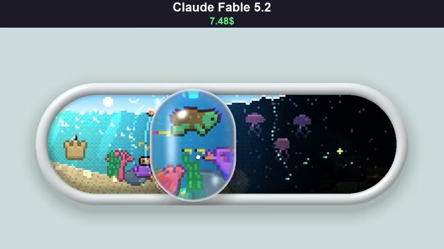

[← Back to gallery](../browse/interactive.en.md) · [简体中文](2119883560937001387.md)

# Deep Dive Switch: From Coral to the Abyss

**[NinjaCodex · @N1njaCodex](https://x.com/N1njaCodex)** · 3D & interactive · 11s

> Discovery pool · Source verified; catalog details being completed.

**[▶ Open gallery to play](https://guanmo-ai.github.io/awesome-ai-motion/?lang=en#case-2119883560937001387)** · [Original post](https://x.com/N1njaCodex/status/2119883560937001387)

Click the cover to open the gallery and play.

A transparent handle travels along a capsule, revealing fish, turtles and jellyfish across ocean depths. The creator credits Fable 5.2 with the volume slider.

No public prompt has been verified. [View the original post](https://x.com/N1njaCodex/status/2119883560937001387)

Bookmarks — · Likes — · Views —

## Source record

- Original post: [@N1njaCodex](https://x.com/N1njaCodex/status/2119883560937001387) · 2026-11-09T20:03:21.000Z
- Model attribution: Fable 5.2 · [Creator’s statement](https://x.com/N1njaCodex/status/2119883560937001387)
- Prompt lookup: [Creator post](https://x.com/N1njaCodex/status/2119883560937001387) · 2026-11-15 05:51 UTC
- Cover source: [Original cover source](https://x.com/N1njaCodex/status/2119883560937001387) · 2.389s
- Metrics snapshot: [Original X post](https://x.com/N1njaCodex/status/2119883560937001387) · 2026-11-15 05:51 UTC
- Gallery video source: [Original post media record](https://x.com/N1njaCodex/status/2119883560937001387) · 2026-11-15 05:59 UTC · Post/media correspondence and media response checked; external reference, no re-upload

Model attribution is based on creator statements. Prompts have not been independently rerun; sound and visuals have not received a uniform quality rating. Videos reference original post media, not our uploads; redistribution permission has not been verified.
