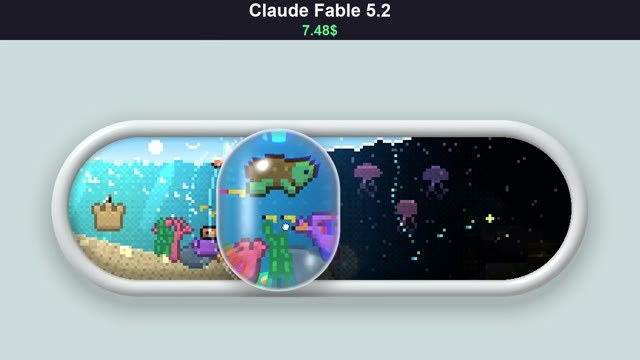

[← 返回图库](../browse/interactive.md) · [English](2119883560937001387.en.md)

# 深潜开关：从珊瑚海滑向深渊

**[NinjaCodex · @N1njaCodex](https://x.com/N1njaCodex)** · 交互演示 · 11s

> 发现池 · 来源已核对，编目资料待完善。

**[▶ 打开画廊播放](https://guanmo-ai.github.io/awesome-ai-motion/#case-2119883560937001387)** · [作者原帖](https://x.com/N1njaCodex/status/2119883560937001387)

点击封面打开画廊播放。

透明拨片沿胶囊滑槽前行，把鱼群、海龟与水母分成由浅到深的海洋层次。作者称这是 Fable 5.2 制作的音量滑块。

未取得作者公开提示词。 [查看作者原帖](https://x.com/N1njaCodex/status/2119883560937001387)

收藏 — · 点赞 — · 浏览 —

## 来源记录

- 作品原帖: [@N1njaCodex](https://x.com/N1njaCodex/status/2119883560937001387) · 2026-11-09T20:03:21.000Z
- 模型归因: Fable 5.2 · [作者说明](https://x.com/N1njaCodex/status/2119883560937001387)
- 提示词查阅记录: [作者原帖](https://x.com/N1njaCodex/status/2119883560937001387) · 2026-11-15 05:51 UTC
- 封面来源: [原帖封面来源](https://x.com/N1njaCodex/status/2119883560937001387) · 2.389s
- 互动快照: [X 原帖](https://x.com/N1njaCodex/status/2119883560937001387) · 2026-11-15 05:51 UTC
- 画廊原视频: [原帖媒体记录](https://x.com/N1njaCodex/status/2119883560937001387) · 2026-11-15 05:59 UTC · 已核对原帖媒体对应与媒体响应；外部引用，不重新上传

模型依据来自作者自述，未独立重跑提示词，也未对音画作统一质量评级。视频引用作者原帖媒体，未由本站重新上传，转载许可未确认。
