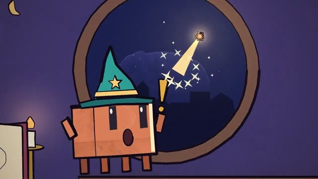

[← Back to gallery](../browse/stories.en.md) · [简体中文](2119885430627913784.md)

# Clawd the Little Wizard Releases a New Model

**[NotinReality · @other\_\_reality](https://x.com/other__reality)** · Narrative films · 26s

> Discovery pool · Source verified; catalog details being completed.

**[▶ Open gallery to play](https://guanmo-ai.github.io/awesome-ai-motion/?lang=en#case-2119885430627913784)** · [Original post](https://x.com/other__reality/status/2119885430627913784)

Click the cover to open the gallery and play.

An orange wizard mascot casts spells in a nighttime study, linking spirals and starlight into a model-launch story. The creator credits Fable 5.2 using an existing animation base.

No public prompt has been verified. [View the original post](https://x.com/other__reality/status/2119885430627913784)

Bookmarks — · Likes — · Views —

## Source record

- Original post: [@other\_\_reality](https://x.com/other__reality/status/2119885430627913784) · 2026-11-09T20:10:46.000Z
- Model attribution: Fable 5.2 · [Creator’s statement](https://x.com/other__reality/status/2119885430627913784)
- Prompt lookup: [Creator post](https://x.com/other__reality/status/2119885430627913784) · 2026-11-15 05:51 UTC
- Cover source: [Original cover source](https://x.com/other__reality/status/2119885430627913784) · 18.72s
- Metrics snapshot: [Original X post](https://x.com/other__reality/status/2119885430627913784) · 2026-11-15 05:51 UTC
- Gallery video source: [Original post media record](https://x.com/other__reality/status/2119885430627913784) · 2026-11-15 05:59 UTC · Post/media correspondence and media response checked; external reference, no re-upload

Model attribution is based on creator statements. Prompts have not been independently rerun; sound and visuals have not received a uniform quality rating. Videos reference original post media, not our uploads; redistribution permission has not been verified.
