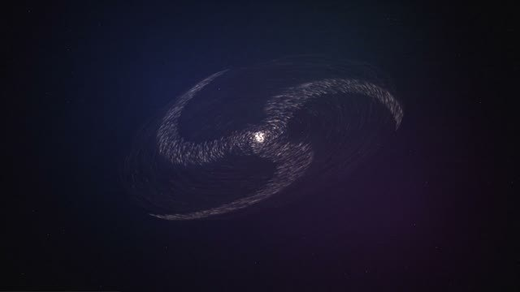

[← Back to gallery](../browse/motion.en.md) · [简体中文](2119888070283845716.md)

# A Spark Writes Fable's Introduction

**[Sotiris Kaniras · @itssotsot](https://x.com/itssotsot)** · Motion design · 29s

> Discovery pool · Source verified; catalog details being completed.

**[▶ Open gallery to play](https://guanmo-ai.github.io/awesome-ai-motion/?lang=en#case-2119888070283845716)** · [Original post](https://x.com/itssotsot/status/2119888070283845716)

Click the cover to open the gallery and play.

Particles expand from a spark into vortices and galaxies before resolving into the model's name. The creator credits Fable 5.2 and pure JavaScript.

No public prompt has been verified. [View the original post](https://x.com/itssotsot/status/2119888070283845716)

Bookmarks — · Likes — · Views —

## Source record

- Original post: [@itssotsot](https://x.com/itssotsot/status/2119888070283845716) · 2026-11-09T20:21:16.000Z
- Model attribution: Fable 5.2 · [Creator’s statement](https://x.com/itssotsot/status/2119888070283845716)
- Prompt lookup: [Creator post](https://x.com/itssotsot/status/2119888070283845716) · 2026-11-15 05:51 UTC
- Cover source: [Original cover source](https://x.com/itssotsot/status/2119888070283845716) · 6.483s
- Metrics snapshot: [Original X post](https://x.com/itssotsot/status/2119888070283845716) · 2026-11-15 05:51 UTC
- Gallery video source: [Original post media record](https://x.com/itssotsot/status/2119888070283845716) · 2026-11-15 05:59 UTC · Post/media correspondence and media response checked; external reference, no re-upload

Model attribution is based on creator statements. Prompts have not been independently rerun; sound and visuals have not received a uniform quality rating. Videos reference original post media, not our uploads; redistribution permission has not been verified.
