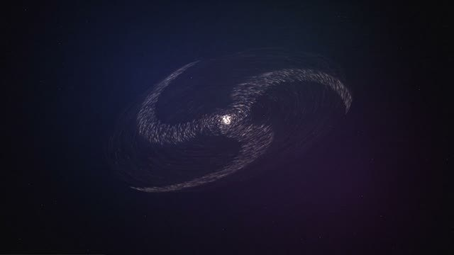

[← 返回图库](../browse/motion.md) · [English](2119888070283845716.en.md)

# 一粒火花写出 Fable 的自我介绍

**[Sotiris Kaniras · @itssotsot](https://x.com/itssotsot)** · 短动效 · 29s

> 发现池 · 来源已核对，编目资料待完善。

**[▶ 打开画廊播放](https://guanmo-ai.github.io/awesome-ai-motion/#case-2119888070283845716)** · [作者原帖](https://x.com/itssotsot/status/2119888070283845716)

点击封面打开画廊播放。

粒子从火花扩展成旋涡与星系，最后聚合成模型名字，以形态变化完成自我介绍。作者称视频由 Fable 5.2 以纯 JavaScript 制作。

未取得作者公开提示词。 [查看作者原帖](https://x.com/itssotsot/status/2119888070283845716)

收藏 — · 点赞 — · 浏览 —

## 来源记录

- 作品原帖: [@itssotsot](https://x.com/itssotsot/status/2119888070283845716) · 2026-11-09T20:21:16.000Z
- 模型归因: Fable 5.2 · [作者说明](https://x.com/itssotsot/status/2119888070283845716)
- 提示词查阅记录: [作者原帖](https://x.com/itssotsot/status/2119888070283845716) · 2026-11-15 05:51 UTC
- 封面来源: [原帖封面来源](https://x.com/itssotsot/status/2119888070283845716) · 6.483s
- 互动快照: [X 原帖](https://x.com/itssotsot/status/2119888070283845716) · 2026-11-15 05:51 UTC
- 画廊原视频: [原帖媒体记录](https://x.com/itssotsot/status/2119888070283845716) · 2026-11-15 05:59 UTC · 已核对原帖媒体对应与媒体响应；外部引用，不重新上传

模型依据来自作者自述，未独立重跑提示词，也未对音画作统一质量评级。视频引用作者原帖媒体，未由本站重新上传，转载许可未确认。
