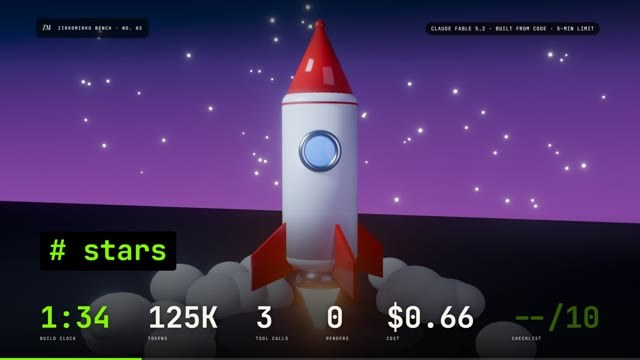

[← Back to gallery](../browse/characters.en.md) · [简体中文](2119896335843529121.md)

# A Cartoon Rocket Lifts from Its Build Site to the Moon

**[Zirko Mirko · @ZirkoMirko](https://x.com/ZirkoMirko)** · Pixel art & characters · 14s

> Discovery pool · Source verified; catalog details being completed.

**[▶ Open gallery to play](https://guanmo-ai.github.io/awesome-ai-motion/?lang=en#case-2119896335843529121)** · [Original post](https://x.com/ZirkoMirko/status/2119896335843529121)

Click the cover to open the gallery and play.

A red-and-white rocket moves from its build site into a starry voyage through flame, stars and changing planetary views. The creator credits Fable 5.2.

No public prompt has been verified. [View the original post](https://x.com/ZirkoMirko/status/2119896335843529121)

Bookmarks — · Likes — · Views —

## Source record

- Original post: [@ZirkoMirko](https://x.com/ZirkoMirko/status/2119896335843529121) · 2026-11-09T20:54:06.000Z
- Model attribution: Fable 5.2 · [Creator’s statement](https://x.com/ZirkoMirko/status/2119896335843529121)
- Prompt lookup: [Creator post](https://x.com/ZirkoMirko/status/2119896335843529121) · 2026-11-15 05:51 UTC
- Cover source: [Original cover source](https://x.com/ZirkoMirko/status/2119896335843529121) · 3.043s
- Metrics snapshot: [Original X post](https://x.com/ZirkoMirko/status/2119896335843529121) · 2026-11-15 05:51 UTC
- Gallery video source: [Original post media record](https://x.com/ZirkoMirko/status/2119896335843529121) · 2026-11-15 05:59 UTC · Post/media correspondence and media response checked; external reference, no re-upload

Model attribution is based on creator statements. Prompts have not been independently rerun; sound and visuals have not received a uniform quality rating. Videos reference original post media, not our uploads; redistribution permission has not been verified.
