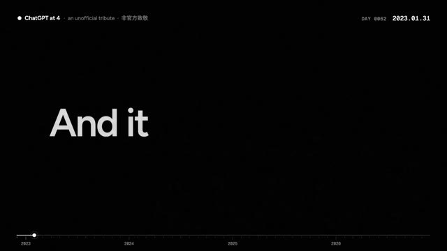

[← Back to gallery](../browse/motion.en.md) · [简体中文](2119902325460590834.md)

# An Unofficial Motion Tribute to ChatGPT's Fourth Anniversary

**[数字生命卡兹克 · @Khazix0918](https://x.com/Khazix0918)** · Motion design · 58s

> Discovery pool · Source verified; catalog details being completed.

**[▶ Open gallery to play](https://guanmo-ai.github.io/awesome-ai-motion/?lang=en#case-2119902325460590834)** · [Original post](https://x.com/Khazix0918/status/2119902325460590834)

Click the cover to open the gallery and play.

Large type, year markers and a glowing horizon form an unofficial anniversary tribute through scaling and cuts. The creator credits Fable 5.2.

No public prompt has been verified. [View the original post](https://x.com/Khazix0918/status/2119902325460590834)

Bookmarks — · Likes — · Views —

## Source record

- Original post: [@Khazix0918](https://x.com/Khazix0918/status/2119902325460590834) · 2026-11-09T21:17:54.000Z
- Model attribution: Fable 5.2 · [Creator’s statement](https://x.com/Khazix0918/status/2119902325460590834)
- Prompt lookup: [Creator post](https://x.com/Khazix0918/status/2119902325460590834) · 2026-11-15 05:51 UTC
- Cover source: [Original cover source](https://x.com/Khazix0918/status/2119902325460590834) · 12.771s
- Metrics snapshot: [Original X post](https://x.com/Khazix0918/status/2119902325460590834) · 2026-11-15 05:51 UTC
- Gallery video source: [Original post media record](https://x.com/Khazix0918/status/2119902325460590834) · 2026-11-15 05:59 UTC · Post/media correspondence and media response checked; external reference, no re-upload

Model attribution is based on creator statements. Prompts have not been independently rerun; sound and visuals have not received a uniform quality rating. Videos reference original post media, not our uploads; redistribution permission has not been verified.
