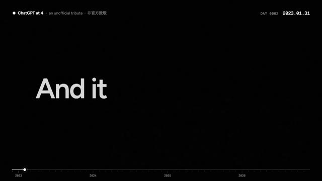

[← 返回图库](../browse/motion.md) · [English](2119902325460590834.en.md)

# ChatGPT 四周年的非官方庆生动效

**[数字生命卡兹克 · @Khazix0918](https://x.com/Khazix0918)** · 短动效 · 58s

> 发现池 · 来源已核对，编目资料待完善。

**[▶ 打开画廊播放](https://guanmo-ai.github.io/awesome-ai-motion/#case-2119902325460590834)** · [作者原帖](https://x.com/Khazix0918/status/2119902325460590834)

点击封面打开画廊播放。

黑底大字、年份刻度与发光地平线串起一支非官方庆生短片，文字以缩放和切换形成节奏。作者明确使用 Fable 5.2。

未取得作者公开提示词。 [查看作者原帖](https://x.com/Khazix0918/status/2119902325460590834)

收藏 — · 点赞 — · 浏览 —

## 来源记录

- 作品原帖: [@Khazix0918](https://x.com/Khazix0918/status/2119902325460590834) · 2026-11-09T21:17:54.000Z
- 模型归因: Fable 5.2 · [作者说明](https://x.com/Khazix0918/status/2119902325460590834)
- 提示词查阅记录: [作者原帖](https://x.com/Khazix0918/status/2119902325460590834) · 2026-11-15 05:51 UTC
- 封面来源: [原帖封面来源](https://x.com/Khazix0918/status/2119902325460590834) · 12.771s
- 互动快照: [X 原帖](https://x.com/Khazix0918/status/2119902325460590834) · 2026-11-15 05:51 UTC
- 画廊原视频: [原帖媒体记录](https://x.com/Khazix0918/status/2119902325460590834) · 2026-11-15 05:59 UTC · 已核对原帖媒体对应与媒体响应；外部引用，不重新上传

模型依据来自作者自述，未独立重跑提示词，也未对音画作统一质量评级。视频引用作者原帖媒体，未由本站重新上传，转载许可未确认。
