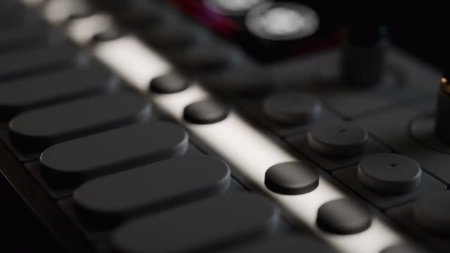

[← Back to gallery](../browse/music.en.md) · [简体中文](2119903338078564844.md)

# A Pocket Synthesizer: Keys and Knobs in Close-Up

**[AmirMušić · @AmirMushich](https://x.com/AmirMushich)** · Music & lyrics · 10s

> Discovery pool · Source verified; catalog details being completed.

**[▶ Open gallery to play](https://guanmo-ai.github.io/awesome-ai-motion/?lang=en#case-2119903338078564844)** · [Original post](https://x.com/AmirMushich/status/2119903338078564844)

Click the cover to open the gallery and play.

Shallow-focus shots move across synthesizer keys and knobs in a ten-second sequence. The creator credits Fable 5.2, Blender and Reaper, with some self-recorded sounds.

No public prompt has been verified. [View the original post](https://x.com/AmirMushich/status/2119903338078564844)

Bookmarks — · Likes — · Views —

## Source record

- Original post: [@AmirMushich](https://x.com/AmirMushich/status/2119903338078564844) · 2026-11-09T21:21:56.000Z
- Model attribution: Fable 5.2 · [Creator’s statement](https://x.com/AmirMushich/status/2119903338078564844)
- Prompt lookup: [Creator post](https://x.com/AmirMushich/status/2119903338078564844) · 2026-11-15 05:51 UTC
- Cover source: [Original cover source](https://x.com/AmirMushich/status/2119903338078564844) · 2.211s
- Metrics snapshot: [Original X post](https://x.com/AmirMushich/status/2119903338078564844) · 2026-11-15 05:51 UTC
- Gallery video source: [Original post media record](https://x.com/AmirMushich/status/2119903338078564844) · 2026-11-15 05:59 UTC · Post/media correspondence and media response checked; external reference, no re-upload

Model attribution is based on creator statements. Prompts have not been independently rerun; sound and visuals have not received a uniform quality rating. Videos reference original post media, not our uploads; redistribution permission has not been verified.
