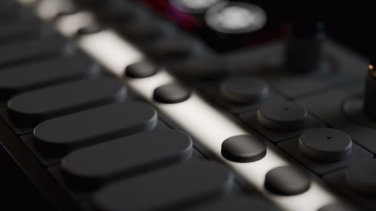

[← 返回图库](../browse/music.md) · [English](2119903338078564844.en.md)

# 口袋合成器：琴键与旋钮的近景节奏

**[AmirMušić · @AmirMushich](https://x.com/AmirMushich)** · 音乐与歌词 · 10s

> 发现池 · 来源已核对，编目资料待完善。

**[▶ 打开画廊播放](https://guanmo-ai.github.io/awesome-ai-motion/#case-2119903338078564844)** · [作者原帖](https://x.com/AmirMushich/status/2119903338078564844)

点击封面打开画廊播放。

浅景深镜头掠过合成器琴键与旋钮，部件动作和声音共同构成十秒演示。作者使用 Fable 5.2、Blender 与 Reaper，并说明部分声音来自自行录制。

未取得作者公开提示词。 [查看作者原帖](https://x.com/AmirMushich/status/2119903338078564844)

收藏 — · 点赞 — · 浏览 —

## 来源记录

- 作品原帖: [@AmirMushich](https://x.com/AmirMushich/status/2119903338078564844) · 2026-11-09T21:21:56.000Z
- 模型归因: Fable 5.2 · [作者说明](https://x.com/AmirMushich/status/2119903338078564844)
- 提示词查阅记录: [作者原帖](https://x.com/AmirMushich/status/2119903338078564844) · 2026-11-15 05:51 UTC
- 封面来源: [原帖封面来源](https://x.com/AmirMushich/status/2119903338078564844) · 2.211s
- 互动快照: [X 原帖](https://x.com/AmirMushich/status/2119903338078564844) · 2026-11-15 05:51 UTC
- 画廊原视频: [原帖媒体记录](https://x.com/AmirMushich/status/2119903338078564844) · 2026-11-15 05:59 UTC · 已核对原帖媒体对应与媒体响应；外部引用，不重新上传

模型依据来自作者自述，未独立重跑提示词，也未对音画作统一质量评级。视频引用作者原帖媒体，未由本站重新上传，转载许可未确认。
