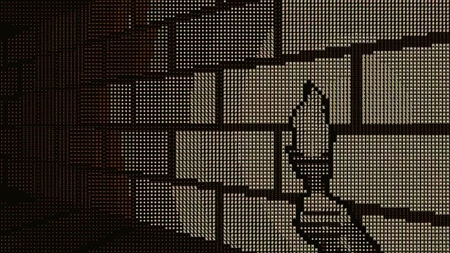

[← Back to gallery](../browse/motion.en.md) · [简体中文](2119906280118845704.md)

# A Torchlit Dungeon Drawn in ASCII

**[josen · @josendev](https://x.com/josendev)** · Motion design · 8s

> Discovery pool · Source verified; catalog details being completed.

**[▶ Open gallery to play](https://guanmo-ai.github.io/awesome-ai-motion/?lang=en#case-2119906280118845704)** · [Original post](https://x.com/josendev/status/2119906280118845704)

Click the cover to open the gallery and play.

Character shading forms stone walls, arches and hanging lamps as camera movement turns the text grid into a continuous space. The creator credits this remake to Fable 5.2.

No public prompt has been verified. [View the original post](https://x.com/josendev/status/2119906280118845704)

Bookmarks — · Likes — · Views —

## Source record

- Original post: [@josendev](https://x.com/josendev/status/2119906280118845704) · 2026-11-09T21:33:37.000Z
- Model attribution: Fable 5.2 · [Creator’s statement](https://x.com/josendev/status/2119906280118845704)
- Prompt lookup: [Creator post](https://x.com/josendev/status/2119906280118845704) · 2026-11-15 05:51 UTC
- Cover source: [Original cover source](https://x.com/josendev/status/2119906280118845704) · 1.76s
- Metrics snapshot: [Original X post](https://x.com/josendev/status/2119906280118845704) · 2026-11-15 05:51 UTC
- Gallery video source: [Original post media record](https://x.com/josendev/status/2119906280118845704) · 2026-11-15 05:59 UTC · Post/media correspondence and media response checked; external reference, no re-upload

Model attribution is based on creator statements. Prompts have not been independently rerun; sound and visuals have not received a uniform quality rating. Videos reference original post media, not our uploads; redistribution permission has not been verified.
