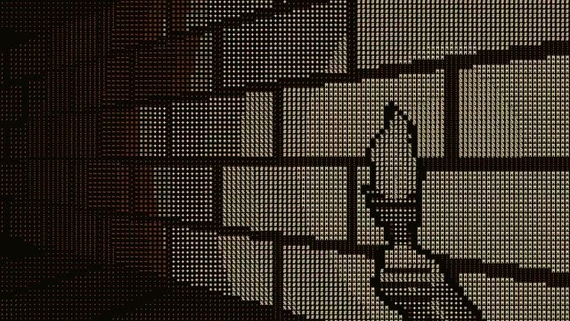

[← 返回图库](../browse/motion.md) · [English](2119906280118845704.en.md)

# ASCII 字符里的火把地牢

**[josen · @josendev](https://x.com/josendev)** · 短动效 · 8s

> 发现池 · 来源已核对，编目资料待完善。

**[▶ 打开画廊播放](https://guanmo-ai.github.io/awesome-ai-motion/#case-2119906280118845704)** · [作者原帖](https://x.com/josendev/status/2119906280118845704)

点击封面打开画廊播放。

字符明暗构成石墙、拱门和吊灯，镜头穿行时让字阵变成连续的三维空间。作者明确这是 Fable 5.2 重做的动画。

未取得作者公开提示词。 [查看作者原帖](https://x.com/josendev/status/2119906280118845704)

收藏 — · 点赞 — · 浏览 —

## 来源记录

- 作品原帖: [@josendev](https://x.com/josendev/status/2119906280118845704) · 2026-11-09T21:33:37.000Z
- 模型归因: Fable 5.2 · [作者说明](https://x.com/josendev/status/2119906280118845704)
- 提示词查阅记录: [作者原帖](https://x.com/josendev/status/2119906280118845704) · 2026-11-15 05:51 UTC
- 封面来源: [原帖封面来源](https://x.com/josendev/status/2119906280118845704) · 1.76s
- 互动快照: [X 原帖](https://x.com/josendev/status/2119906280118845704) · 2026-11-15 05:51 UTC
- 画廊原视频: [原帖媒体记录](https://x.com/josendev/status/2119906280118845704) · 2026-11-15 05:59 UTC · 已核对原帖媒体对应与媒体响应；外部引用，不重新上传

模型依据来自作者自述，未独立重跑提示词，也未对音画作统一质量评级。视频引用作者原帖媒体，未由本站重新上传，转载许可未确认。
