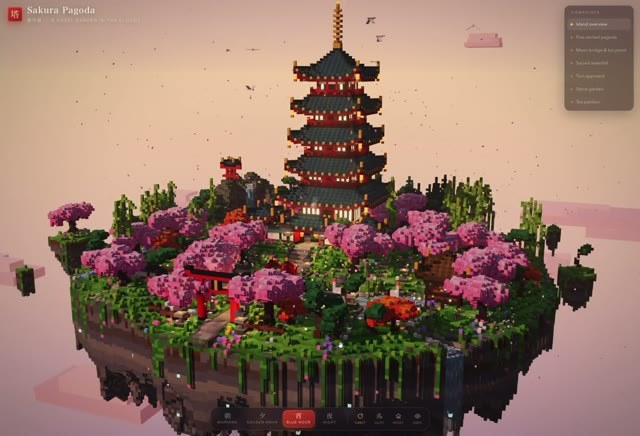

[← Back to gallery](../browse/interactive.en.md) · [简体中文](2119907096636657696.md)

# A Voxel Pagoda Island Through Day and Night

**[Lumina · @LuminaBench](https://x.com/LuminaBench)** · 3D & interactive · 47s

> Discovery pool · Source verified; catalog details being completed.

**[▶ Open gallery to play](https://guanmo-ai.github.io/awesome-ai-motion/?lang=en#case-2119907096636657696)** · [Original post](https://x.com/LuminaBench/status/2119907096636657696)

Click the cover to open the gallery and play.

The camera moves from a complete pagoda island into cherry trees, water and lanterns, with voxel detail and changing light shaping the space. The creator credits Fable 5.2.

No public prompt has been verified. [View the original post](https://x.com/LuminaBench/status/2119907096636657696)

Bookmarks — · Likes — · Views —

## Source record

- Original post: [@LuminaBench](https://x.com/LuminaBench/status/2119907096636657696) · 2026-11-09T21:36:52.000Z
- Model attribution: Fable 5.2 · [Creator’s statement](https://x.com/LuminaBench/status/2119907096636657696)
- Prompt lookup: [Creator post](https://x.com/LuminaBench/status/2119907096636657696) · 2026-11-15 05:51 UTC
- Cover source: [Original cover source](https://x.com/LuminaBench/status/2119907096636657696) · 10.404s
- Metrics snapshot: [Original X post](https://x.com/LuminaBench/status/2119907096636657696) · 2026-11-15 05:51 UTC
- Gallery video source: [Original post media record](https://x.com/LuminaBench/status/2119907096636657696) · 2026-11-15 05:59 UTC · Post/media correspondence and media response checked; external reference, no re-upload

Model attribution is based on creator statements. Prompts have not been independently rerun; sound and visuals have not received a uniform quality rating. Videos reference original post media, not our uploads; redistribution permission has not been verified.
