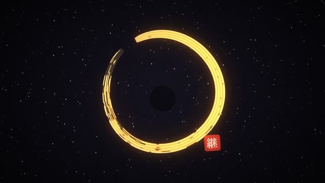

[← Back to gallery](../browse/motion.en.md) · [简体中文](2120007289071640613.md)

# Kintsugi: Patterns Fracture and Rejoin in Gold

**[にらまよ · @niramayo2096](https://x.com/niramayo2096)** · Motion design · 20s

> Discovery pool · Source verified; catalog details being completed.

**[▶ Open gallery to play](https://guanmo-ai.github.io/awesome-ai-motion/?lang=en#case-2120007289071640613)** · [Original post](https://x.com/niramayo2096/status/2120007289071640613)

Click the cover to open the gallery and play.

A gold ring and layered Japanese patterns grow, fracture and regroup on black. The creator says Fable 5.2 made the visuals and sound entirely in code.

No public prompt has been verified. [View the original post](https://x.com/niramayo2096/status/2120007289071640613)

Bookmarks — · Likes — · Views —

## Source record

- Original post: [@niramayo2096](https://x.com/niramayo2096/status/2120007289071640613) · 2026-11-10T04:15:00.000Z
- Model attribution: Fable 5.2 · [Creator’s statement](https://x.com/niramayo2096/status/2120007289071640613)
- Prompt lookup: [Creator post](https://x.com/niramayo2096/status/2120007289071640613) · 2026-11-15 05:51 UTC
- Cover source: [Original cover source](https://x.com/niramayo2096/status/2120007289071640613) · 4.414s
- Metrics snapshot: [Original X post](https://x.com/niramayo2096/status/2120007289071640613) · 2026-11-15 05:51 UTC
- Gallery video source: [Original post media record](https://x.com/niramayo2096/status/2120007289071640613) · 2026-11-15 05:59 UTC · Post/media correspondence and media response checked; external reference, no re-upload

Model attribution is based on creator statements. Prompts have not been independently rerun; sound and visuals have not received a uniform quality rating. Videos reference original post media, not our uploads; redistribution permission has not been verified.
