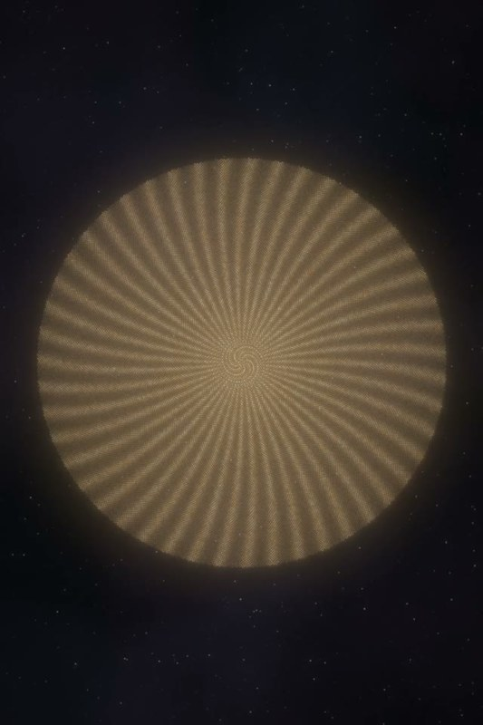

[← Back to gallery](../browse/motion.en.md) · [简体中文](2120008595458928930.md)

# 2027: Rotating Particles and Accelerating Research

**[sonder berry · @Midnightballoon](https://x.com/Midnightballoon)** · Motion design · 56s

> Discovery pool · Source verified; catalog details being completed.

**[▶ Open gallery to play](https://guanmo-ai.github.io/awesome-ai-motion/?lang=en#case-2120008595458928930)** · [Original post](https://x.com/Midnightballoon/status/2120008595458928930)

Click the cover to open the gallery and play.

Golden radial lines gather into particle spheres as vertical captions alternate with changing forms around an accelerating-research theme. The post credits Fable 5.2.

No public prompt has been verified. [View the original post](https://x.com/Midnightballoon/status/2120008595458928930)

Bookmarks — · Likes — · Views —

## Source record

- Original post: [@Midnightballoon](https://x.com/Midnightballoon/status/2120008595458928930) · 2026-11-10T04:20:11.000Z
- Model attribution: Fable 5.2 · [Creator’s statement](https://x.com/Midnightballoon/status/2120008595458928930)
- Prompt lookup: [Creator post](https://x.com/Midnightballoon/status/2120008595458928930) · 2026-11-15 05:51 UTC
- Cover source: [Original cover source](https://x.com/Midnightballoon/status/2120008595458928930) · 12.301s
- Metrics snapshot: [Original X post](https://x.com/Midnightballoon/status/2120008595458928930) · 2026-11-15 05:51 UTC
- Gallery video source: [Original post media record](https://x.com/Midnightballoon/status/2120008595458928930) · 2026-11-15 05:59 UTC · Post/media correspondence and media response checked; external reference, no re-upload

Model attribution is based on creator statements. Prompts have not been independently rerun; sound and visuals have not received a uniform quality rating. Videos reference original post media, not our uploads; redistribution permission has not been verified.
