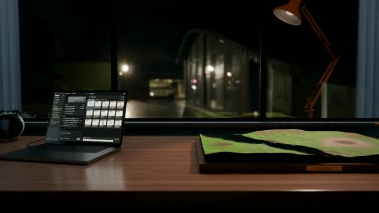

[← Back to gallery](../browse/stories.en.md) · [简体中文](2120008924204310895.md)

# Assembly: A Miniature Forest on a Desk

**[John Holliman · @j\_h\_h\_3](https://x.com/j_h_h_3)** · Narrative films · 60s

> Discovery pool · Source verified; catalog details being completed.

**[▶ Open gallery to play](https://guanmo-ai.github.io/awesome-ai-motion/?lang=en#case-2120008924204310895)** · [Original post](https://x.com/j_h_h_3/status/2120008924204310895)

Click the cover to open the gallery and play.

The camera moves from a desk into miniature terrain and treetops beneath a starry sky. The creator credits Fable 5.2, Voyager and Vork.

No public prompt has been verified. [View the original post](https://x.com/j_h_h_3/status/2120008924204310895)

Bookmarks — · Likes — · Views —

## Source record

- Original post: [@j\_h\_h\_3](https://x.com/j_h_h_3/status/2120008924204310895) · 2026-11-10T04:21:30.000Z
- Model attribution: Fable 5.2 · [Creator’s statement](https://x.com/j_h_h_3/status/2120008924204310895)
- Prompt lookup: [Creator post](https://x.com/j_h_h_3/status/2120008924204310895) · 2026-11-15 05:51 UTC
- Cover source: [Original cover source](https://x.com/j_h_h_3/status/2120008924204310895) · 13.212s
- Metrics snapshot: [Original X post](https://x.com/j_h_h_3/status/2120008924204310895) · 2026-11-15 05:51 UTC
- Gallery video source: [Original post media record](https://x.com/j_h_h_3/status/2120008924204310895) · 2026-11-15 05:59 UTC · Post/media correspondence and media response checked; external reference, no re-upload

Model attribution is based on creator statements. Prompts have not been independently rerun; sound and visuals have not received a uniform quality rating. Videos reference original post media, not our uploads; redistribution permission has not been verified.
