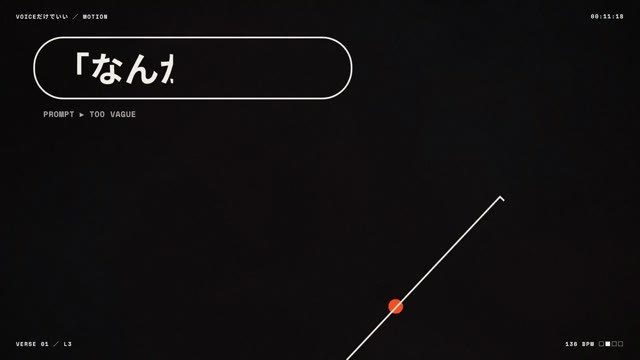

[← Back to gallery](../browse/music.en.md) · [简体中文](2120014216753262816.md)

# Voice Is Enough: Japanese Lyric Motion

**[伊藤貴將（いとぱん）｜AI創作ラボ 仲間募集中🤝 · @takamasa045](https://x.com/takamasa045)** · Music & lyrics · 53s

> Discovery pool · Source verified; catalog details being completed.

**[▶ Open gallery to play](https://guanmo-ai.github.io/awesome-ai-motion/?lang=en#case-2120014216753262816)** · [Original post](https://x.com/takamasa045/status/2120014216753262816)

Click the cover to open the gallery and play.

Cream type, orange accents and fine lines alternate on black, changing scale and composition with the lyric sections. The creator identifies this as the Fable 5.2 remake.

No public prompt has been verified. [View the original post](https://x.com/takamasa045/status/2120014216753262816)

Bookmarks — · Likes — · Views —

## Source record

- Original post: [@takamasa045](https://x.com/takamasa045/status/2120014216753262816) · 2026-11-10T04:42:31.000Z
- Model attribution: Fable 5.2 · [Creator’s statement](https://x.com/takamasa045/status/2120014216753262816)
- Prompt lookup: [Creator post](https://x.com/takamasa045/status/2120014216753262816) · 2026-11-15 05:51 UTC
- Cover source: [Original cover source](https://x.com/takamasa045/status/2120014216753262816) · 11.583s
- Metrics snapshot: [Original X post](https://x.com/takamasa045/status/2120014216753262816) · 2026-11-15 05:51 UTC
- Gallery video source: [Original post media record](https://x.com/takamasa045/status/2120014216753262816) · 2026-11-15 05:59 UTC · Post/media correspondence and media response checked; external reference, no re-upload

Model attribution is based on creator statements. Prompts have not been independently rerun; sound and visuals have not received a uniform quality rating. Videos reference original post media, not our uploads; redistribution permission has not been verified.
