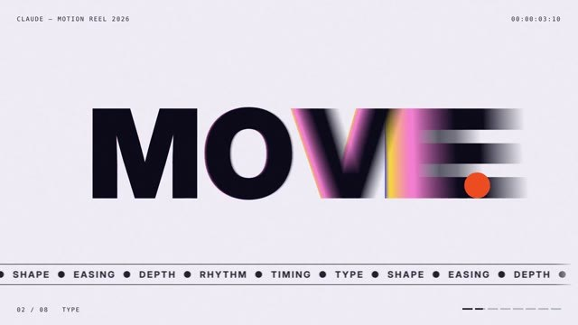

[← Back to gallery](../browse/motion.en.md) · [简体中文](2120017106804900304.md)

# MOVE: A Reel of Type, Easing and Radial Shapes

**[hims · @himanshutwtxs](https://x.com/himanshutwtxs)** · Motion design · 15s

> Discovery pool · Source verified; catalog details being completed.

**[▶ Open gallery to play](https://guanmo-ai.github.io/awesome-ai-motion/?lang=en#case-2120017106804900304)** · [Original post](https://x.com/himanshutwtxs/status/2120017106804900304)

Click the cover to open the gallery and play.

Large type stretches and splits through masks before blue-and-yellow radial shapes take over. This fifteen-second reel is the creator's Fable 5.2 version.

The creator has shared instructions; this catalog links to the source without redistributing the full text or translation. [Read the creator’s original](https://x.com/himanshutwtxs/status/2120017106804900304)

Bookmarks — · Likes — · Views —

## Source record

- Original post: [@himanshutwtxs](https://x.com/himanshutwtxs/status/2120017106804900304) · 2026-11-10T04:54:00.000Z
- Model attribution: Fable 5.2 · [Creator’s statement](https://x.com/himanshutwtxs/status/2120017106804900304)
- Prompt source: [Creator post](https://x.com/himanshutwtxs/status/2120017106804900304) · 2026-11-15 05:51 UTC
- Cover source: [Original cover source](https://x.com/himanshutwtxs/status/2120017106804900304) · 3.313s
- Metrics snapshot: [Original X post](https://x.com/himanshutwtxs/status/2120017106804900304) · 2026-11-15 05:51 UTC
- Gallery video source: [Original post media record](https://x.com/himanshutwtxs/status/2120017106804900304) · 2026-11-15 05:59 UTC · Post/media correspondence and media response checked; external reference, no re-upload

Model attribution is based on creator statements. Prompts have not been independently rerun; sound and visuals have not received a uniform quality rating. Videos reference original post media, not our uploads; redistribution permission has not been verified.
