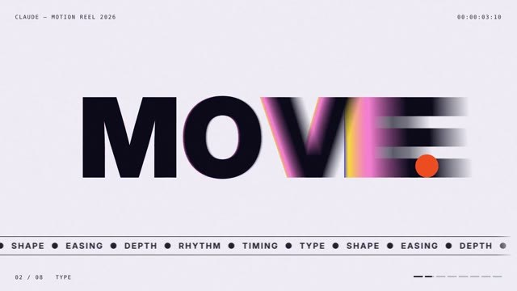

[← 返回图库](../browse/motion.md) · [English](2120017106804900304.en.md)

# MOVE：字体、缓动与放射图形作品集

**[hims · @himanshutwtxs](https://x.com/himanshutwtxs)** · 短动效 · 15s

> 发现池 · 来源已核对，编目资料待完善。

**[▶ 打开画廊播放](https://guanmo-ai.github.io/awesome-ai-motion/#case-2120017106804900304)** · [作者原帖](https://x.com/himanshutwtxs/status/2120017106804900304)

点击封面打开画廊播放。

大字被拉伸、遮罩和切开，蓝黄放射图形接续旋转，形成十五秒的动态设计作品集。当前视频为作者的 Fable 5.2 版本。

作者已公开指令；本站仅提供原帖入口，不再分发全文或译文。 [查看作者原文](https://x.com/himanshutwtxs/status/2120017106804900304)

收藏 — · 点赞 — · 浏览 —

## 来源记录

- 作品原帖: [@himanshutwtxs](https://x.com/himanshutwtxs/status/2120017106804900304) · 2026-11-10T04:54:00.000Z
- 模型归因: Fable 5.2 · [作者说明](https://x.com/himanshutwtxs/status/2120017106804900304)
- 提示词出处: [作者原帖](https://x.com/himanshutwtxs/status/2120017106804900304) · 2026-11-15 05:51 UTC
- 封面来源: [原帖封面来源](https://x.com/himanshutwtxs/status/2120017106804900304) · 3.313s
- 互动快照: [X 原帖](https://x.com/himanshutwtxs/status/2120017106804900304) · 2026-11-15 05:51 UTC
- 画廊原视频: [原帖媒体记录](https://x.com/himanshutwtxs/status/2120017106804900304) · 2026-11-15 05:59 UTC · 已核对原帖媒体对应与媒体响应；外部引用，不重新上传

模型依据来自作者自述，未独立重跑提示词，也未对音画作统一质量评级。视频引用作者原帖媒体，未由本站重新上传，转载许可未确认。
