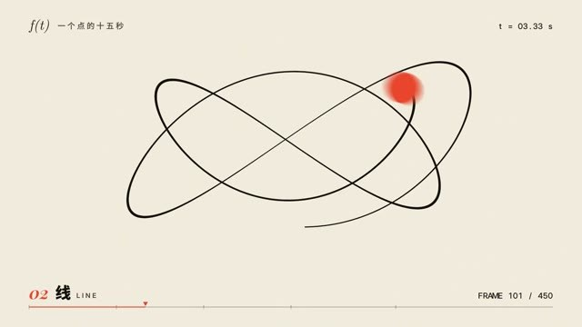

[← Back to gallery](../browse/motion.en.md) · [简体中文](2120017167848763821.md)

# Fifteen Seconds of a Point: Line, Form and Type

**[Freedom \| AI · @FreedomAIG](https://x.com/FreedomAIG)** · Motion design · 15s

> Discovery pool · Source verified; catalog details being completed.

**[▶ Open gallery to play](https://guanmo-ai.github.io/awesome-ai-motion/?lang=en#case-2120017167848763821)** · [Original post](https://x.com/FreedomAIG/status/2120017167848763821)

Click the cover to open the gallery and play.

Black paths weave around a red point before cutting to bold Chinese typography, with a running clock and chapter labels. The post identifies this attachment as Fable 5.2.

No public prompt has been verified. [View the original post](https://x.com/FreedomAIG/status/2120017167848763821)

Bookmarks — · Likes — · Views —

## Source record

- Original post: [@FreedomAIG](https://x.com/FreedomAIG/status/2120017167848763821) · 2026-11-10T04:54:15.000Z
- Model attribution: Fable 5.2 · [Creator’s statement](https://x.com/FreedomAIG/status/2120017167848763821)
- Prompt lookup: [Creator post](https://x.com/FreedomAIG/status/2120017167848763821) · 2026-11-15 05:51 UTC
- Cover source: [Original cover source](https://x.com/FreedomAIG/status/2120017167848763821) · 3.313s
- Metrics snapshot: [Original X post](https://x.com/FreedomAIG/status/2120017167848763821) · 2026-11-15 05:51 UTC
- Gallery video source: [Original post media record](https://x.com/FreedomAIG/status/2120017167848763821) · 2026-11-15 05:59 UTC · Post/media correspondence and media response checked; external reference, no re-upload

Model attribution is based on creator statements. Prompts have not been independently rerun; sound and visuals have not received a uniform quality rating. Videos reference original post media, not our uploads; redistribution permission has not been verified.
