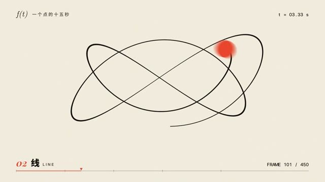

[← 返回图库](../browse/motion.md) · [English](2120017167848763821.en.md)

# 一个点的十五秒：线、形与文字

**[Freedom \| AI · @FreedomAIG](https://x.com/FreedomAIG)** · 短动效 · 15s

> 发现池 · 来源已核对，编目资料待完善。

**[▶ 打开画廊播放](https://guanmo-ai.github.io/awesome-ai-motion/#case-2120017167848763821)** · [作者原帖](https://x.com/FreedomAIG/status/2120017167848763821)

点击封面打开画廊播放。

黑色轨迹围绕红点交织，随后切到高对比的中文排版，计时与章节标签贯穿画面。原帖明确当前附件使用 Fable 5.2。

未取得作者公开提示词。 [查看作者原帖](https://x.com/FreedomAIG/status/2120017167848763821)

收藏 — · 点赞 — · 浏览 —

## 来源记录

- 作品原帖: [@FreedomAIG](https://x.com/FreedomAIG/status/2120017167848763821) · 2026-11-10T04:54:15.000Z
- 模型归因: Fable 5.2 · [作者说明](https://x.com/FreedomAIG/status/2120017167848763821)
- 提示词查阅记录: [作者原帖](https://x.com/FreedomAIG/status/2120017167848763821) · 2026-11-15 05:51 UTC
- 封面来源: [原帖封面来源](https://x.com/FreedomAIG/status/2120017167848763821) · 3.313s
- 互动快照: [X 原帖](https://x.com/FreedomAIG/status/2120017167848763821) · 2026-11-15 05:51 UTC
- 画廊原视频: [原帖媒体记录](https://x.com/FreedomAIG/status/2120017167848763821) · 2026-11-15 05:59 UTC · 已核对原帖媒体对应与媒体响应；外部引用，不重新上传

模型依据来自作者自述，未独立重跑提示词，也未对音画作统一质量评级。视频引用作者原帖媒体，未由本站重新上传，转载许可未确认。
