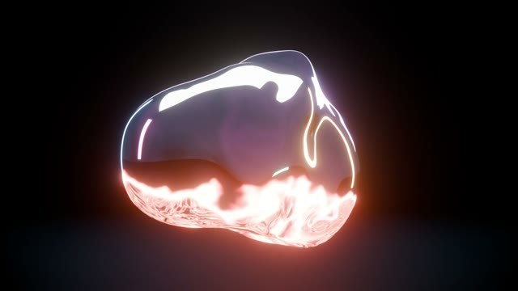

[← Back to gallery](../browse/motion.en.md) · [简体中文](2120024077930996126.md)

# Genesis: Liquid, Particles and Luminous Cities

**[つやっと🍎ゲーム開発中 · @tsuyatsuyatt](https://x.com/tsuyatsuyatt)** · Motion design · 46s

> Discovery pool · Source verified; catalog details being completed.

**[▶ Open gallery to play](https://guanmo-ai.github.io/awesome-ai-motion/?lang=en#case-2120024077930996126)** · [Original post](https://x.com/tsuyatsuyatt/status/2120024077930996126)

Click the cover to open the gallery and play.

A luminous liquid close-up transitions into geometric spaces of particles and buildings, with the camera following a central light axis. The creator credits Fable 5.2.

No public prompt has been verified. [View the original post](https://x.com/tsuyatsuyatt/status/2120024077930996126)

Bookmarks — · Likes — · Views —

## Source record

- Original post: [@tsuyatsuyatt](https://x.com/tsuyatsuyatt/status/2120024077930996126) · 2026-11-10T05:21:42.000Z
- Model attribution: Fable 5.2 · [Creator’s statement](https://x.com/tsuyatsuyatt/status/2120024077930996126)
- Prompt lookup: [Creator post](https://x.com/tsuyatsuyatt/status/2120024077930996126) · 2026-11-15 05:51 UTC
- Cover source: [Original cover source](https://x.com/tsuyatsuyatt/status/2120024077930996126) · 10.095s
- Metrics snapshot: [Original X post](https://x.com/tsuyatsuyatt/status/2120024077930996126) · 2026-11-15 05:51 UTC
- Gallery video source: [Original post media record](https://x.com/tsuyatsuyatt/status/2120024077930996126) · 2026-11-15 05:59 UTC · Post/media correspondence and media response checked; external reference, no re-upload

Model attribution is based on creator statements. Prompts have not been independently rerun; sound and visuals have not received a uniform quality rating. Videos reference original post media, not our uploads; redistribution permission has not been verified.
