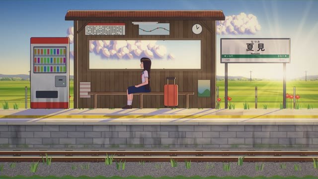

[← Back to gallery](../browse/stories.en.md) · [简体中文](2120026164479545578.md)

# The Last Bus of Summer

**[Tejas · @TejasThange3](https://x.com/TejasThange3)** · Narrative films · 77s

> Discovery pool · Source verified; catalog details being completed.

**[▶ Open gallery to play](https://guanmo-ai.github.io/awesome-ai-motion/?lang=en#case-2120026164479545578)** · [Original post](https://x.com/TejasThange3/status/2120026164479545578)

Click the cover to open the gallery and play.

A rural station gives way to a character beside a bus window as fields and sky move toward sunset. The creator credits a single Fable 5.2 attempt.

No public prompt has been verified. [View the original post](https://x.com/TejasThange3/status/2120026164479545578)

Bookmarks — · Likes — · Views —

## Source record

- Original post: [@TejasThange3](https://x.com/TejasThange3/status/2120026164479545578) · 2026-11-10T05:30:00.000Z
- Model attribution: Fable 5.2 · [Creator’s statement](https://x.com/TejasThange3/status/2120026164479545578)
- Prompt lookup: [Creator post](https://x.com/TejasThange3/status/2120026164479545578) · 2026-11-15 05:51 UTC
- Cover source: [Original cover source](https://x.com/TejasThange3/status/2120026164479545578) · 16.83s
- Metrics snapshot: [Original X post](https://x.com/TejasThange3/status/2120026164479545578) · 2026-11-15 05:51 UTC
- Gallery video source: [Original post media record](https://x.com/TejasThange3/status/2120026164479545578) · 2026-11-15 05:59 UTC · Post/media correspondence and media response checked; external reference, no re-upload

Model attribution is based on creator statements. Prompts have not been independently rerun; sound and visuals have not received a uniform quality rating. Videos reference original post media, not our uploads; redistribution permission has not been verified.
