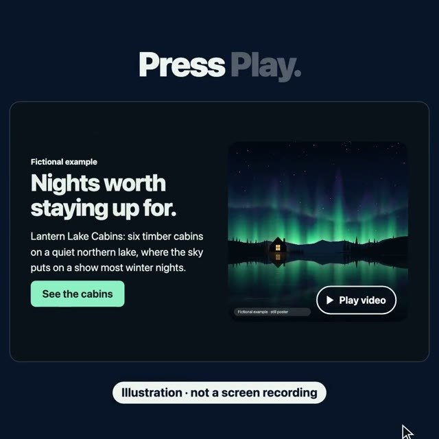

[← Back to gallery](../browse/product.en.md) · [简体中文](2120027646071283723.md)

# Hero in Motion: Motion on Request

**[Augusto Builds · @AugustoBuilds](https://x.com/AugustoBuilds)** · Product & marketing · 16s

> Discovery pool · Source verified; catalog details being completed.

**[▶ Open gallery to play](https://guanmo-ai.github.io/awesome-ai-motion/?lang=en#case-2120027646071283723)** · [Original post](https://x.com/AugustoBuilds/status/2120027646071283723)

Click the cover to open the gallery and play.

[Hero in Motion project with the matching film](https://github.com/augustobuilds/hero-in-motion) · [Try the opt-in video hero](https://augustobuilds.github.io/hero-in-motion/)

Kinetic type, illustrated cards and an aurora cabin explain playback, pausing and missing-video states in sixteen seconds. The creator shares the matching Fable 5.2 project.

## Source & web pages

- **Direct source**：[Hero in Motion project with the matching film](https://github.com/augustobuilds/hero-in-motion) · [MIT](https://github.com/augustobuilds/hero-in-motion/blob/main/LICENSE)
  [Link source](https://x.com/AugustoBuilds/status/2120027646071283723) · Link checked 2026-11-15 05:59 UTC
- **Public web page**：[Try the opt-in video hero](https://augustobuilds.github.io/hero-in-motion/)
  [Link source](https://x.com/AugustoBuilds/status/2120027646071283723) · Link checked 2026-11-15 05:59 UTC

No public prompt has been verified. [View the original post](https://x.com/AugustoBuilds/status/2120027646071283723)

Bookmarks — · Likes — · Views —

## Source record

- Original post: [@AugustoBuilds](https://x.com/AugustoBuilds/status/2120027646071283723) · 2026-11-10T05:35:53.000Z
- Model attribution: Fable 5.2 · [Creator’s statement](https://x.com/AugustoBuilds/status/2120027646071283723)
- Prompt lookup: [Creator post](https://x.com/AugustoBuilds/status/2120027646071283723) · 2026-11-15 05:51 UTC
- Cover source: [Original cover source](https://x.com/AugustoBuilds/status/2120027646071283723) · 3.539s
- Metrics snapshot: [Original X post](https://x.com/AugustoBuilds/status/2120027646071283723) · 2026-11-15 05:51 UTC
- Gallery video source: [Original post media record](https://x.com/AugustoBuilds/status/2120027646071283723) · 2026-11-15 05:59 UTC · Post/media correspondence and media response checked; external reference, no re-upload

Model attribution is based on creator statements. Prompts have not been independently rerun; sound and visuals have not received a uniform quality rating. Videos reference original post media, not our uploads; redistribution permission has not been verified.
