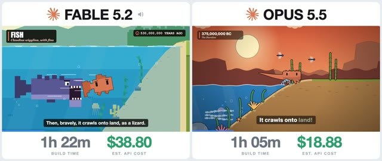

[← 返回图库](../browse/characters.md) · [English](2120028715258425413.en.md)

# Claude 吉祥物进化史：两款模型的并排动画

**[Dubibubi · @Dubibubiii](https://x.com/Dubibubiii)** · 角色动画 · 89s

> 发现池 · 来源已核对，编目资料待完善。

**[▶ 打开画廊播放](https://guanmo-ai.github.io/awesome-ai-motion/#case-2120028715258425413)** · [作者原帖](https://x.com/Dubibubiii/status/2120028715258425413)

点击封面打开画廊播放。

同一段吉祥物进化故事并排呈现两种动画：从海洋生物到陆地角色与城市生活。原帖对照 Fable 5.2 和 Opus 5.5，旁白另由 FishAudio 生成。

未取得作者公开提示词。 [查看作者原帖](https://x.com/Dubibubiii/status/2120028715258425413)

收藏 — · 点赞 — · 浏览 —

## 来源记录

- 作品原帖: [@Dubibubiii](https://x.com/Dubibubiii/status/2120028715258425413) · 2026-11-10T05:40:08.000Z
- 模型归因: Fable 5.2 / Claude Opus 5.5 · [作者说明](https://x.com/Dubibubiii/status/2120028715258425413)
- 提示词查阅记录: [作者原帖](https://x.com/Dubibubiii/status/2120028715258425413) · 2026-11-15 05:51 UTC
- 封面来源: [原帖封面来源](https://x.com/Dubibubiii/status/2120028715258425413) · 19.507s
- 互动快照: [X 原帖](https://x.com/Dubibubiii/status/2120028715258425413) · 2026-11-15 05:51 UTC
- 画廊原视频: [原帖媒体记录](https://x.com/Dubibubiii/status/2120028715258425413) · 2026-11-15 05:59 UTC · 已核对原帖媒体对应与媒体响应；外部引用，不重新上传

模型依据来自作者自述，未独立重跑提示词，也未对音画作统一质量评级。视频引用作者原帖媒体，未由本站重新上传，转载许可未确认。
