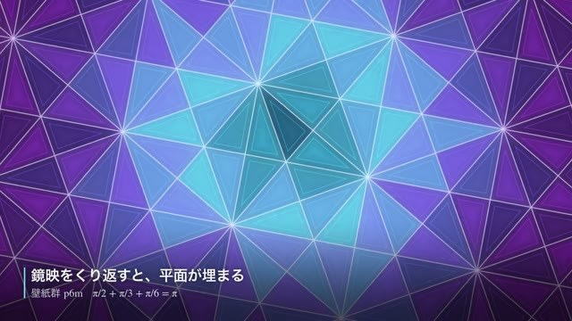

[← Back to gallery](../browse/education.en.md) · [简体中文](2120029845572993504.md)

# A Journey Through Symmetry: One Triangle, Four Mirrors

**[結城浩 / Hiroshi Yuki · @hyuki](https://x.com/hyuki)** · Education & explainers · 30s

> Discovery pool · Source verified; catalog details being completed.

**[▶ Open gallery to play](https://guanmo-ai.github.io/awesome-ai-motion/?lang=en#case-2120029845572993504)** · [Original post](https://x.com/hyuki/status/2120029845572993504)

Click the cover to open the gallery and play.

Mirrored triangles tile a plane before transforming into circular curves and hyperbolic patterns. The creator says Fable 5.2 generated both visuals and music in code.

No public prompt has been verified. [View the original post](https://x.com/hyuki/status/2120029845572993504)

Bookmarks — · Likes — · Views —

## Source record

- Original post: [@hyuki](https://x.com/hyuki/status/2120029845572993504) · 2026-11-10T05:44:38.000Z
- Model attribution: Fable 5.2 · [Creator’s statement](https://x.com/hyuki/status/2120029845572993504)
- Prompt lookup: [Creator post](https://x.com/hyuki/status/2120029845572993504) · 2026-11-15 05:51 UTC
- Cover source: [Original cover source](https://x.com/hyuki/status/2120029845572993504) · 6.613s
- Metrics snapshot: [Original X post](https://x.com/hyuki/status/2120029845572993504) · 2026-11-15 05:51 UTC
- Gallery video source: [Original post media record](https://x.com/hyuki/status/2120029845572993504) · 2026-11-15 05:59 UTC · Post/media correspondence and media response checked; external reference, no re-upload

Model attribution is based on creator statements. Prompts have not been independently rerun; sound and visuals have not received a uniform quality rating. Videos reference original post media, not our uploads; redistribution permission has not been verified.
