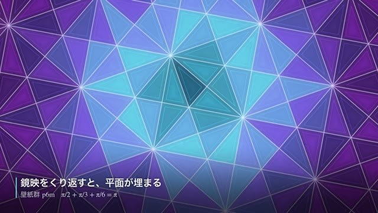

[← 返回图库](../browse/education.md) · [English](2120029845572993504.en.md)

# 对称性之旅：三角形与四面镜子

**[結城浩 / Hiroshi Yuki · @hyuki](https://x.com/hyuki)** · 知识讲解 · 30s

> 发现池 · 来源已核对，编目资料待完善。

**[▶ 打开画廊播放](https://guanmo-ai.github.io/awesome-ai-motion/#case-2120029845572993504)** · [作者原帖](https://x.com/hyuki/status/2120029845572993504)

点击封面打开画廊播放。

三角形镜像铺满平面，继而变成环状曲线与双曲几何图案。作者说明图像和音乐均由 Fable 5.2 以代码生成。

未取得作者公开提示词。 [查看作者原帖](https://x.com/hyuki/status/2120029845572993504)

收藏 — · 点赞 — · 浏览 —

## 来源记录

- 作品原帖: [@hyuki](https://x.com/hyuki/status/2120029845572993504) · 2026-11-10T05:44:38.000Z
- 模型归因: Fable 5.2 · [作者说明](https://x.com/hyuki/status/2120029845572993504)
- 提示词查阅记录: [作者原帖](https://x.com/hyuki/status/2120029845572993504) · 2026-11-15 05:51 UTC
- 封面来源: [原帖封面来源](https://x.com/hyuki/status/2120029845572993504) · 6.613s
- 互动快照: [X 原帖](https://x.com/hyuki/status/2120029845572993504) · 2026-11-15 05:51 UTC
- 画廊原视频: [原帖媒体记录](https://x.com/hyuki/status/2120029845572993504) · 2026-11-15 05:59 UTC · 已核对原帖媒体对应与媒体响应；外部引用，不重新上传

模型依据来自作者自述，未独立重跑提示词，也未对音画作统一质量评级。视频引用作者原帖媒体，未由本站重新上传，转载许可未确认。
