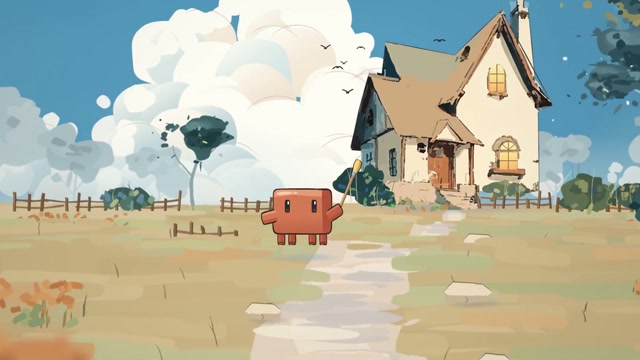

[← Back to gallery](../browse/characters.en.md) · [简体中文](2120179018964324566.md)

# Claude Mascot's Journey Through a Hand-Drawn Town

**[Chetaslua · @chetaslua](https://x.com/chetaslua)** · Pixel art & characters · 34s

> Discovery pool · Source verified; catalog details being completed.

**[▶ Open gallery to play](https://guanmo-ai.github.io/awesome-ai-motion/?lang=en#case-2120179018964324566)** · [Original post](https://x.com/chetaslua/status/2120179018964324566)

Click the cover to open the gallery and play.

An orange Claude mascot travels from line-drawn streets into a watercolor countryside of houses, grass and clouds. The creator credits Fable 5.2 and pure JavaScript.

No public prompt has been verified. [View the original post](https://x.com/chetaslua/status/2120179018964324566)

Bookmarks — · Likes — · Views —

## Source record

- Original post: [@chetaslua](https://x.com/chetaslua/status/2120179018964324566) · 2026-11-10T15:37:23.000Z
- Model attribution: Fable 5.2 · [Creator’s statement](https://x.com/chetaslua/status/2120179018964324566)
- Prompt lookup: [Creator post](https://x.com/chetaslua/status/2120179018964324566) · 2026-11-10 16:11 UTC
- Cover source: [Original cover source](https://x.com/chetaslua/status/2120179018964324566) · 21.321s
- Metrics snapshot: [Original X post](https://x.com/chetaslua/status/2120179018964324566) · 2026-11-10 16:11 UTC
- Gallery video source: [Original post media record](https://x.com/chetaslua/status/2120179018964324566) · 2026-11-10 16:11 UTC · Post/media correspondence and media response checked; external reference, no re-upload

Model attribution is based on creator statements. Prompts have not been independently rerun; sound and visuals have not received a uniform quality rating. Videos reference original post media, not our uploads; redistribution permission has not been verified.
