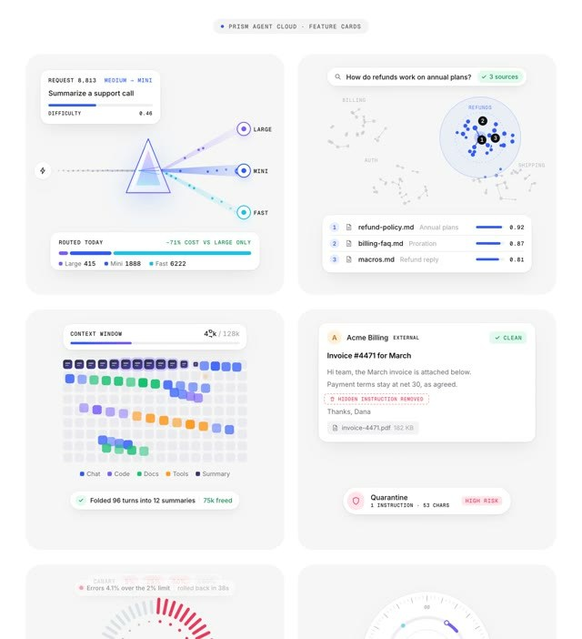

[← Back to gallery](../browse/motion.en.md) · [简体中文](2120919476174827528.md)

# Agent Card Motion II: Routing, Context and Metrics

**[Csaba Kissi · @csaba\_kissi](https://x.com/csaba_kissi)** · Motion design · 25s

> Discovery pool · Source verified; catalog details being completed.

**[▶ Open gallery to play](https://guanmo-ai.github.io/awesome-ai-motion/?lang=en#case-2120919476174827528)** · [Original post](https://x.com/csaba_kissi/status/2120919476174827528)

Click the cover to open the gallery and play.

Prism-like routing paths, folding context blocks and changing metrics form a second component set using continuous microanimations. The creator again credits Opus 5.5.

No public prompt has been verified. [View the original post](https://x.com/csaba_kissi/status/2120919476174827528)

Bookmarks — · Likes — · Views —

## Source record

- Original post: [@csaba\_kissi](https://x.com/csaba_kissi/status/2120919476174827528) · 2026-11-12T16:39:42.000Z
- Model attribution: Claude Opus 5.5 · [Creator’s statement](https://x.com/csaba_kissi/status/2120919476174827528)
- Prompt lookup: [Creator post](https://x.com/csaba_kissi/status/2120919476174827528) · 2026-11-15 05:51 UTC
- Cover source: [Original cover source](https://x.com/csaba_kissi/status/2120919476174827528) · 5.427s
- Metrics snapshot: [Original X post](https://x.com/csaba_kissi/status/2120919476174827528) · 2026-11-15 05:51 UTC
- Gallery video source: [Original post media record](https://x.com/csaba_kissi/status/2120919476174827528) · 2026-11-15 05:59 UTC · Post/media correspondence and media response checked; external reference, no re-upload

Model attribution is based on creator statements. Prompts have not been independently rerun; sound and visuals have not received a uniform quality rating. Videos reference original post media, not our uploads; redistribution permission has not been verified.
