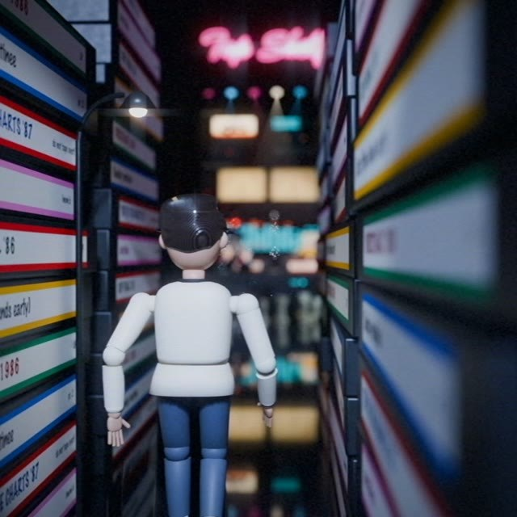

[← Back to gallery](../browse/music.en.md) · [简体中文](2120948511038648596.md)

# An Eighties Music Video in a Cassette Shop

**[Kevin Ngo · @kevin\_t\_ngo](https://x.com/kevin_t_ngo)** · Music & lyrics · 139s

> Discovery pool · Source verified; catalog details being completed.

**[▶ Open gallery to play](https://guanmo-ai.github.io/awesome-ai-motion/?lang=en#case-2120948511038648596)** · [Original post](https://x.com/kevin_t_ngo/status/2120948511038648596)

Click the cover to open the gallery and play.

Cameras travel through cassette shelves into a miniature synth stage with cartoon performers. The creator credits Fable 5.2 with Python animation rendered in Blender.

No public prompt has been verified. [View the original post](https://x.com/kevin_t_ngo/status/2120948511038648596)

Bookmarks — · Likes — · Views —

## Source record

- Original post: [@kevin\_t\_ngo](https://x.com/kevin_t_ngo/status/2120948511038648596) · 2026-11-12T18:35:05.000Z
- Model attribution: Fable 5.2 · [Creator’s statement](https://x.com/kevin_t_ngo/status/2120948511038648596)
- Prompt lookup: [Creator post](https://x.com/kevin_t_ngo/status/2120948511038648596) · 2026-11-15 05:51 UTC
- Cover source: [Original cover source](https://x.com/kevin_t_ngo/status/2120948511038648596) · 30.483s
- Metrics snapshot: [Original X post](https://x.com/kevin_t_ngo/status/2120948511038648596) · 2026-11-15 05:51 UTC
- Gallery video source: [Original post media record](https://x.com/kevin_t_ngo/status/2120948511038648596) · 2026-11-15 05:59 UTC · Post/media correspondence and media response checked; external reference, no re-upload

Model attribution is based on creator statements. Prompts have not been independently rerun; sound and visuals have not received a uniform quality rating. Videos reference original post media, not our uploads; redistribution permission has not been verified.
