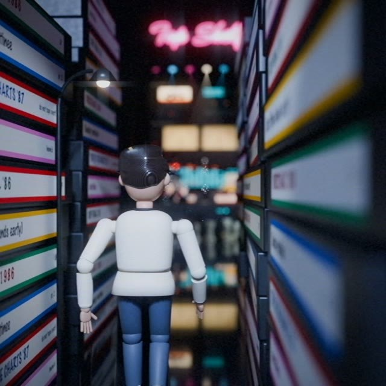

[← 返回图库](../browse/music.md) · [English](2120948511038648596.en.md)

# 磁带店里的八十年代音乐短片

**[Kevin Ngo · @kevin\_t\_ngo](https://x.com/kevin_t_ngo)** · 音乐与歌词 · 139s

> 发现池 · 来源已核对，编目资料待完善。

**[▶ 打开画廊播放](https://guanmo-ai.github.io/awesome-ai-motion/#case-2120948511038648596)** · [作者原帖](https://x.com/kevin_t_ngo/status/2120948511038648596)

点击封面打开画廊播放。

唱片货架、合成器舞台与卡通歌手组成微缩音乐世界，镜头穿过货架再切入演出。作者称 Fable 5.2 编写 Python 动画并由 Blender 渲染。

未取得作者公开提示词。 [查看作者原帖](https://x.com/kevin_t_ngo/status/2120948511038648596)

收藏 — · 点赞 — · 浏览 —

## 来源记录

- 作品原帖: [@kevin\_t\_ngo](https://x.com/kevin_t_ngo/status/2120948511038648596) · 2026-11-12T18:35:05.000Z
- 模型归因: Fable 5.2 · [作者说明](https://x.com/kevin_t_ngo/status/2120948511038648596)
- 提示词查阅记录: [作者原帖](https://x.com/kevin_t_ngo/status/2120948511038648596) · 2026-11-15 05:51 UTC
- 封面来源: [原帖封面来源](https://x.com/kevin_t_ngo/status/2120948511038648596) · 30.483s
- 互动快照: [X 原帖](https://x.com/kevin_t_ngo/status/2120948511038648596) · 2026-11-15 05:51 UTC
- 画廊原视频: [原帖媒体记录](https://x.com/kevin_t_ngo/status/2120948511038648596) · 2026-11-15 05:59 UTC · 已核对原帖媒体对应与媒体响应；外部引用，不重新上传

模型依据来自作者自述，未独立重跑提示词，也未对音画作统一质量评级。视频引用作者原帖媒体，未由本站重新上传，转载许可未确认。
