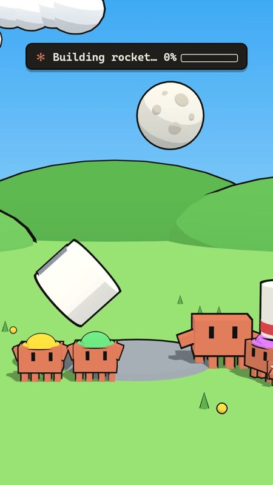

[← Back to gallery](../browse/stories.en.md) · [简体中文](2121279507390996526.md)

# Claude Blocks Build a Rocket to the Moon

**[Scott the VRNerd ☀️🌎🌑 · @TheVRNerd](https://x.com/TheVRNerd)** · Narrative films · 91s

> Discovery pool · Source verified; catalog details being completed.

**[▶ Open gallery to play](https://guanmo-ai.github.io/awesome-ai-motion/?lang=en#case-2121279507390996526)** · [Original post](https://x.com/TheVRNerd/status/2121279507390996526)

Click the cover to open the gallery and play.

Orange block characters carry parts, build a rocket and prepare for a moon trip, with progress labels advancing the story. The creator credits Fable 5.2.

No public prompt has been verified. [View the original post](https://x.com/TheVRNerd/status/2121279507390996526)

Bookmarks — · Likes — · Views —

## Source record

- Original post: [@TheVRNerd](https://x.com/TheVRNerd/status/2121279507390996526) · 2026-11-13T16:30:20.000Z
- Model attribution: Fable 5.2 · [Creator’s statement](https://x.com/TheVRNerd/status/2121279507390996526)
- Prompt lookup: [Creator post](https://x.com/TheVRNerd/status/2121279507390996526) · 2026-11-15 05:51 UTC
- Cover source: [Original cover source](https://x.com/TheVRNerd/status/2121279507390996526) · 20.035s
- Metrics snapshot: [Original X post](https://x.com/TheVRNerd/status/2121279507390996526) · 2026-11-15 05:51 UTC
- Gallery video source: [Original post media record](https://x.com/TheVRNerd/status/2121279507390996526) · 2026-11-15 05:59 UTC · Post/media correspondence and media response checked; external reference, no re-upload

Model attribution is based on creator statements. Prompts have not been independently rerun; sound and visuals have not received a uniform quality rating. Videos reference original post media, not our uploads; redistribution permission has not been verified.
