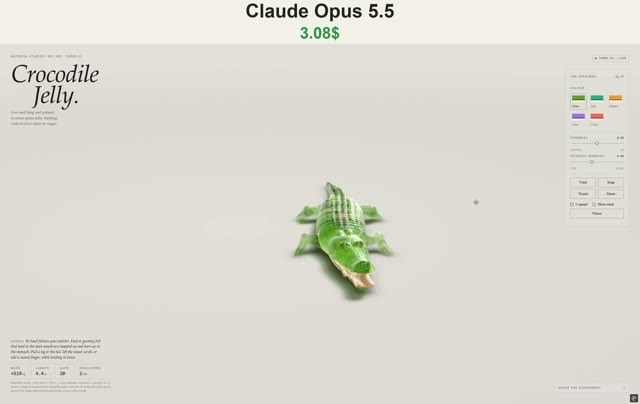

[← Back to gallery](../browse/interactive.en.md) · [简体中文](2121290268779618790.md)

# Crocodile Jelly: Dragging and Rebounding a Soft Reptile

**[Vib3Coded · @vib3coded](https://x.com/vib3coded)** · 3D & interactive · 17s

> Discovery pool · Source verified; catalog details being completed.

**[▶ Open gallery to play](https://guanmo-ai.github.io/awesome-ai-motion/?lang=en#case-2121290268779618790)** · [Original post](https://x.com/vib3coded/status/2121290268779618790)

Click the cover to open the gallery and play.

A jelly crocodile stretches, twists and rebounds while transparency and changing colors emphasize its response. The creator credits Opus 5.5.

No public prompt has been verified. [View the original post](https://x.com/vib3coded/status/2121290268779618790)

Bookmarks — · Likes — · Views —

## Source record

- Original post: [@vib3coded](https://x.com/vib3coded/status/2121290268779618790) · 2026-11-13T17:13:06.000Z
- Model attribution: Claude Opus 5.5 · [Creator’s statement](https://x.com/vib3coded/status/2121290268779618790)
- Prompt lookup: [Creator post](https://x.com/vib3coded/status/2121290268779618790) · 2026-11-15 05:51 UTC
- Cover source: [Original cover source](https://x.com/vib3coded/status/2121290268779618790) · 3.75s
- Metrics snapshot: [Original X post](https://x.com/vib3coded/status/2121290268779618790) · 2026-11-15 05:51 UTC
- Gallery video source: [Original post media record](https://x.com/vib3coded/status/2121290268779618790) · 2026-11-15 05:59 UTC · Post/media correspondence and media response checked; external reference, no re-upload

Model attribution is based on creator statements. Prompts have not been independently rerun; sound and visuals have not received a uniform quality rating. Videos reference original post media, not our uploads; redistribution permission has not been verified.
