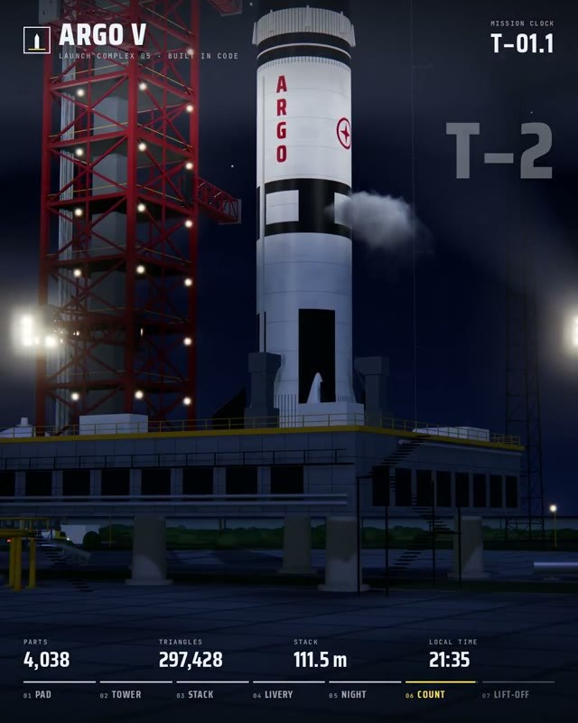

[← Back to gallery](../browse/interactive.en.md) · [简体中文](2121327589990035501.md)

# Argo V: From Crane Assembly to Night Launch

**[0xAnni · @0x\_Anni](https://x.com/0x_Anni)** · 3D & interactive · 29s

> Discovery pool · Source verified; catalog details being completed.

**[▶ Open gallery to play](https://guanmo-ai.github.io/awesome-ai-motion/?lang=en#case-2121327589990035501)** · [Original post](https://x.com/0x_Anni/status/2121327589990035501)

Click the cover to open the gallery and play.

A crane assembles a rocket before daylight gives way to a nighttime countdown, flame and smoke. The creator credits Opus 5.5 with coding every launch-site component.

No public prompt has been verified. [View the original post](https://x.com/0x_Anni/status/2121327589990035501)

Bookmarks — · Likes — · Views —

## Source record

- Original post: [@0x\_Anni](https://x.com/0x_Anni/status/2121327589990035501) · 2026-11-13T19:41:24.000Z
- Model attribution: Claude Opus 5.5 · [Creator’s statement](https://x.com/0x_Anni/status/2121327589990035501)
- Prompt lookup: [Creator post](https://x.com/0x_Anni/status/2121327589990035501) · 2026-11-15 05:51 UTC
- Cover source: [Original cover source](https://x.com/0x_Anni/status/2121327589990035501) · 20.982s
- Metrics snapshot: [Original X post](https://x.com/0x_Anni/status/2121327589990035501) · 2026-11-15 05:51 UTC
- Gallery video source: [Original post media record](https://x.com/0x_Anni/status/2121327589990035501) · 2026-11-15 05:59 UTC · Post/media correspondence and media response checked; external reference, no re-upload

Model attribution is based on creator statements. Prompts have not been independently rerun; sound and visuals have not received a uniform quality rating. Videos reference original post media, not our uploads; redistribution permission has not been verified.
