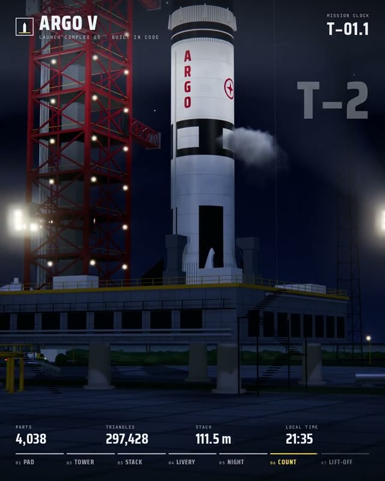

[← 返回图库](../browse/interactive.md) · [English](2121327589990035501.en.md)

# Argo V：从吊装到夜间发射

**[0xAnni · @0x\_Anni](https://x.com/0x_Anni)** · 交互演示 · 29s

> 发现池 · 来源已核对，编目资料待完善。

**[▶ 打开画廊播放](https://guanmo-ai.github.io/awesome-ai-motion/#case-2121327589990035501)** · [作者原帖](https://x.com/0x_Anni/status/2121327589990035501)

点击封面打开画廊播放。

吊车分段组装火箭，白昼施工转入夜间倒计时，再以尾焰和烟雾完成升空。作者称发射场的全部组件由 Opus 5.5 编写代码构建。

未取得作者公开提示词。 [查看作者原帖](https://x.com/0x_Anni/status/2121327589990035501)

收藏 — · 点赞 — · 浏览 —

## 来源记录

- 作品原帖: [@0x\_Anni](https://x.com/0x_Anni/status/2121327589990035501) · 2026-11-13T19:41:24.000Z
- 模型归因: Claude Opus 5.5 · [作者说明](https://x.com/0x_Anni/status/2121327589990035501)
- 提示词查阅记录: [作者原帖](https://x.com/0x_Anni/status/2121327589990035501) · 2026-11-15 05:51 UTC
- 封面来源: [原帖封面来源](https://x.com/0x_Anni/status/2121327589990035501) · 20.982s
- 互动快照: [X 原帖](https://x.com/0x_Anni/status/2121327589990035501) · 2026-11-15 05:51 UTC
- 画廊原视频: [原帖媒体记录](https://x.com/0x_Anni/status/2121327589990035501) · 2026-11-15 05:59 UTC · 已核对原帖媒体对应与媒体响应；外部引用，不重新上传

模型依据来自作者自述，未独立重跑提示词，也未对音画作统一质量评级。视频引用作者原帖媒体，未由本站重新上传，转载许可未确认。
